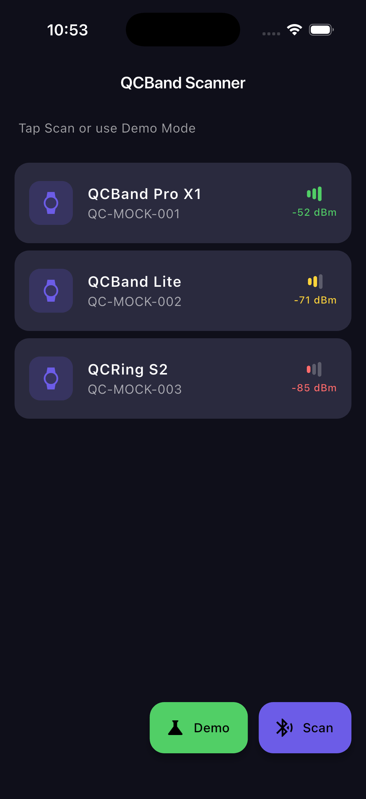
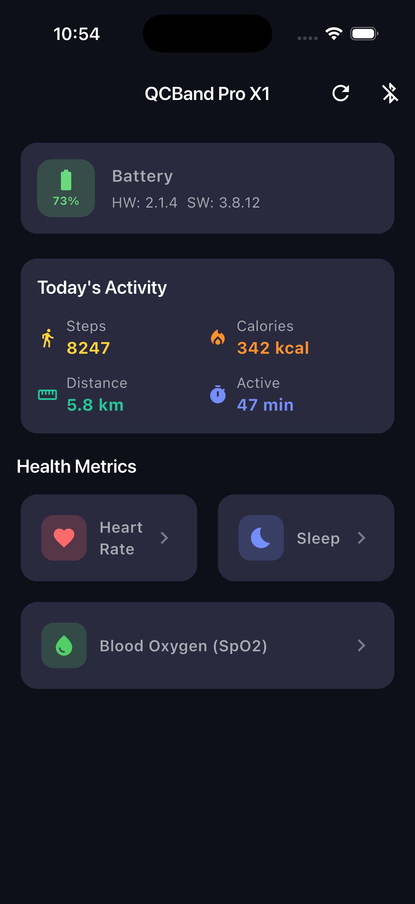
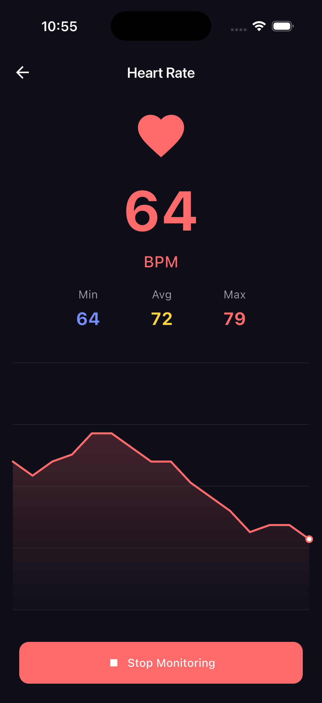
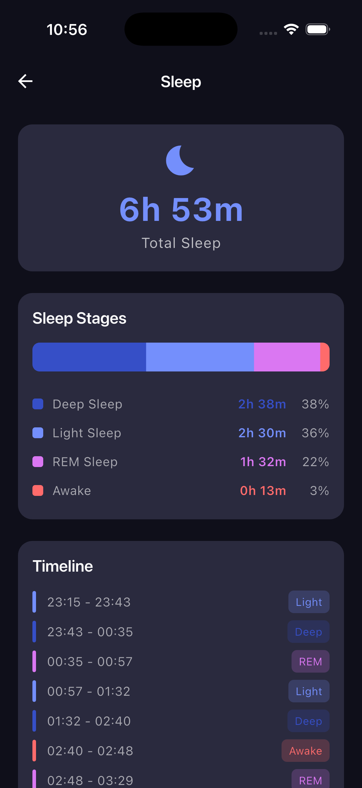
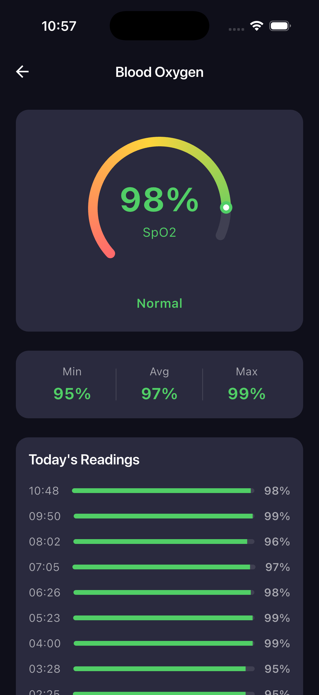

# Flutter QCBand SDK - Health Tracker Bracelet POC

Flutter proof-of-concept wrapping the QCBandSDK (iOS `.framework` + Android `.aar`) via platform channels. Demonstrates bridging a native health bracelet SDK into a single Flutter codebase.

## Screenshots

| Scan | Dashboard | Heart Rate | Sleep | SpO2 |
|------|-----------|------------|-------|------|
|  |  |  |  |  |

## Features

- **BLE Scanning** - Discover nearby QCBand devices with signal strength indicators
- **Device Connection** - Connect/disconnect with real-time state management
- **Device Info** - Sync time, read battery level (73%), firmware version (HW: 2.1.4, SW: 3.8.12)
- **Health Dashboard** - Steps, calories, distance, active minutes for today
- **Real-time Heart Rate** - Live BPM monitoring with animated pulse, min/avg/max stats, CustomPainter chart with gradient fill
- **Sleep Analysis** - Last night's breakdown: deep (38%), light (36%), REM (22%), awake (3%) with stacked bar and timeline
- **Blood Oxygen (SpO2)** - Arc gauge visualization, min/avg/max stats, hourly readings list
- **Demo Mode** - Full app preview on simulator without physical device

## Architecture

```
Flutter (Dart)                    Native (iOS / Android)
+-------------------+            +------------------------+
| Riverpod          |            | QCBandPlugin           |
| Providers         | <-----+   | (MethodChannel +       |
|                   |        |   |  EventChannel)         |
| GoRouter          |        |   |                        |
| /scan -> /dash    |        |   | QCBandCommandQueue     |
|  -> /hr, /sleep   |        |   | (Serial execution,     |
|  -> /spo2         |        |   |  10s timeout)          |
|                   |        |   |                        |
| QCBandRepository  | -------+   | QCBandSDK.framework    |
| (Platform Channel |            | qc_sdk_2.0.12.aar     |
|  wrapper)         |            +------------------------+
+-------------------+
```

### Platform Channel Design

**MethodChannel**: `com.tranthienhau.qcband/methods`

| Method | Args | Returns |
|---|---|---|
| `startScan` | `{timeout: int?}` | void |
| `stopScan` | - | void |
| `connect` | `{peripheralId: String}` | void |
| `disconnect` | - | void |
| `syncTime` | - | `Map` (feature flags) |
| `readBattery` | - | `{level, charging}` |
| `getDeviceVersion` | - | `{hardware, software}` |
| `getCurrentSport` | - | `{steps, calories, distance, activeMinutes}` |
| `getSleepData` | `{dayIndex: int}` | `List<Map>` |
| `getBloodOxygen` | `{dayIndex: int}` | `List<Map>` |
| `startRealTimeHR` | - | void |
| `stopRealTimeHR` | - | void |

**EventChannel**: `com.tranthienhau.qcband/events` (multiplexed by `event` key)

Events: `scanResult`, `connectionState`, `realTimeHeartRate`, `batteryUpdate`, `stepUpdate`

## Key Design Decisions

### Sequential Command Queue
The QCBandSDK requires commands to be sent one at a time. Sending concurrent commands causes later ones to silently fail. Both iOS (`NSOperationQueue` + `dispatch_semaphore`) and Android (`SingleThreadExecutor` + `CountDownLatch`) enforce serial execution with a 10-second timeout per command to prevent deadlocks.

### Native HR Hold Timer
Real-time heart rate monitoring requires a "hold" command every 20 seconds to keep the session alive. This timer runs on the native side to avoid Flutter timer drift affecting the BLE session.

### Feature Detection
`syncTime` returns a feature map from the device. The UI conditionally shows SpO2/blood pressure screens based on device capabilities.

### Demo Mode
Built-in mock data layer (`MockQCBandRepository`) provides realistic fake data for all health metrics, enabling full UI demonstration on iOS Simulator without a physical QCBand device. Activated via the "Demo" button on the scan screen.

## Setup

### iOS

1. Copy `QCBandSDK.framework` to `ios/Runner/Frameworks/`
2. Add framework entries in Xcode (Embed & Sign)
3. Add Info.plist entries from `Info.plist.additions`
4. Register plugin in `AppDelegate.swift`:
   ```swift
   QCBandPlugin.register(with: registrar(forPlugin: "QCBandPlugin")!)
   ```

### Android

1. Copy `qc_sdk_2.0.12.aar` to `android/app/libs/`
2. AAR dependency is already in `build.gradle.kts`
3. Add permissions from `AndroidManifest.xml.additions`
4. Register plugin in `MainActivity.kt`:
   ```kotlin
   flutterEngine.plugins.add(QCBandPlugin())
   ```

## Testing

- **Simulator**: Tap "Demo" on the scan screen to preview all screens with mock data
- **Physical device**: Requires iOS/Android device with Bluetooth and a QCBand bracelet nearby

## Tech Stack

- **Flutter 3.2+** / Dart 3.2+
- **Riverpod** - State management
- **GoRouter** - Navigation
- **CustomPainter** - HR line chart with gradient fill, SpO2 arc gauge
- **Platform Channels** - MethodChannel + EventChannel
- **iOS**: Objective-C plugin, QCBandSDK.framework
- **Android**: Kotlin plugin, qc_sdk_2.0.12.aar
