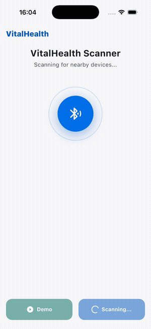
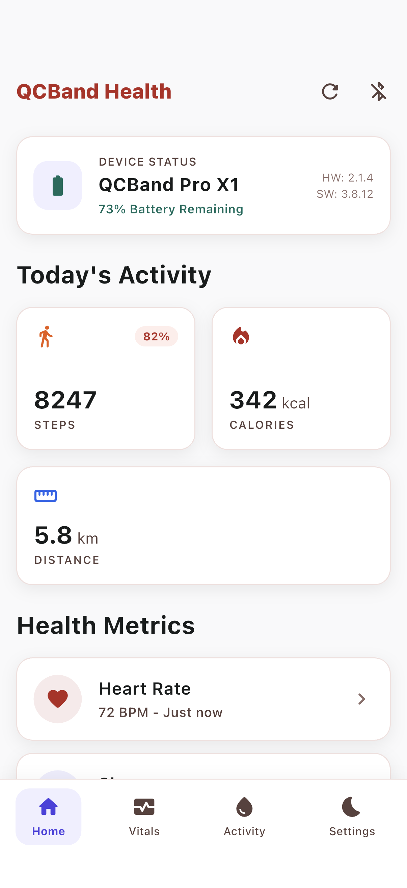
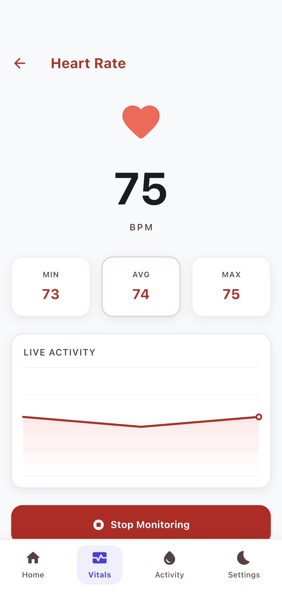
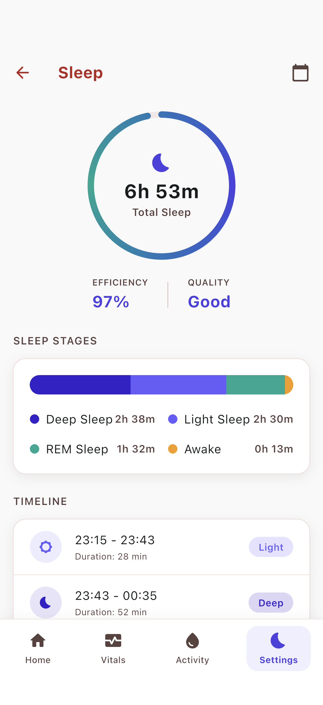
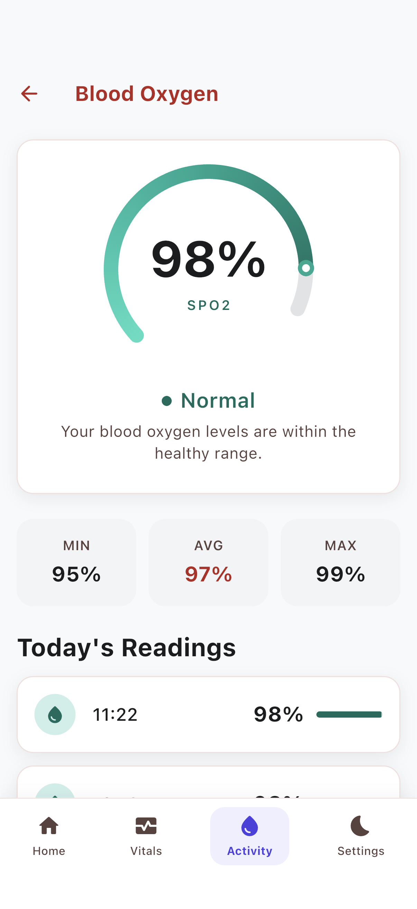
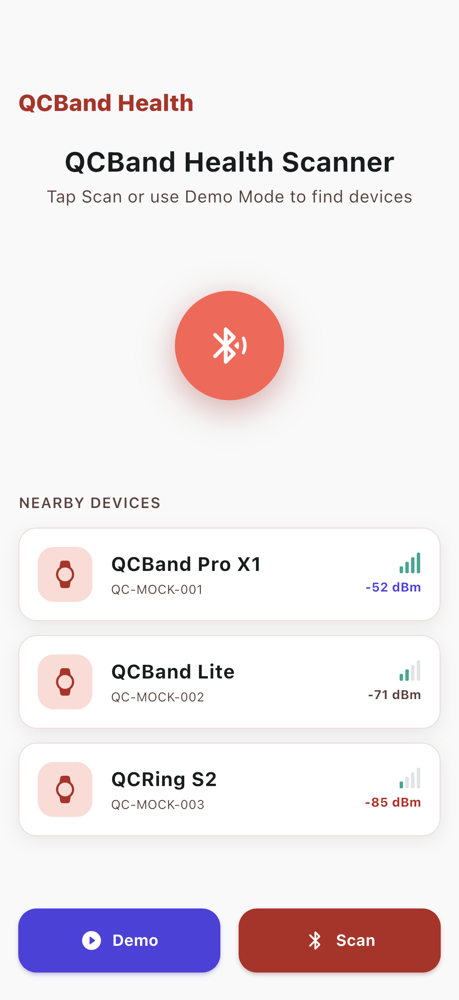
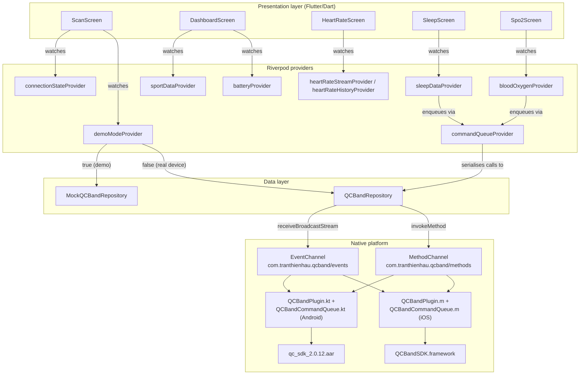

# flutter_qcband_sdk

Flutter proof-of-concept that wraps the **QCBandSDK** (iOS `.framework` + Android `.aar`) via **Flutter Platform Channels** and exposes a full health-bracelet UI built with **Riverpod** state management and **GoRouter** navigation. The app demonstrates BLE scanning, device connection, real-time heart rate monitoring, sleep analysis, and blood-oxygen (SpO2) readings - all exercisable on an iOS Simulator via built-in **Demo Mode** without a physical device.

The UI follows the **Vitality Core** "Clinical Optimism" design system - a bright, vibrant wellness look that colour-codes each health metric: Energetic Coral (`#B32822`) for heart rate and primary actions, Deep Violet (`#4D41DF`) for sleep and recovery, and Teal (`#00A891`) for activity and SpO2. White cards sit on a near-white canvas with Inter typography, soft ambient shadows, and rounded geometry.

## Demo

Live demo recorded on iPhone 17 Pro Simulator (auto-tour through scan -> dashboard -> heart rate -> sleep -> SpO2).



## Screenshots

| Dashboard | Heart Rate | Sleep | SpO2 | Scanner |
|---|---|---|---|---|
|  |  |  |  |  |

## Features

- **BLE Scanning** - Discover nearby QCBand devices with RSSI signal-strength bars
- **Device Connection** - Connect/disconnect with real-time connection-state management
- **Device Info** - Sync time, read battery level, and read firmware/hardware version
- **Health Dashboard** - Bento activity grid (steps with goal %, calories, distance), device-status card, and quick-access health-metric rows
- **Real-time Heart Rate** - Live BPM monitoring with an animated pulse indicator, min/avg/max stats, and a CustomPainter line chart with gradient fill
- **Sleep Analysis** - Last night breakdown across deep, light, REM, and awake segments with a stacked bar and a scrollable timeline
- **Blood Oxygen (SpO2)** - Arc gauge visualization, min/avg/max stats, and an hourly readings list
- **Demo Mode** - Full UI preview on iOS Simulator via `MockQCBandRepository`; no physical bracelet needed
- **Sequential Command Queue** - `CommandQueueService` ensures SDK commands are sent one at a time, matching the QCBandSDK requirement

## Stack

- **Flutter 3.2+ / Dart 3.2+**
- **flutter_riverpod ^2.4.9** - State management (providers, notifiers, streams)
- **go_router ^14.0.0** - Declarative navigation
- **intl ^0.19.0** - Date/time formatting
- **collection ^1.18.0** - List utilities
- **Platform Channels** - `MethodChannel` + `EventChannel` bridging Dart to native SDK
- **iOS native layer** - Objective-C (`QCBandPlugin.m`, `QCBandCommandQueue.m`) wrapping `QCBandSDK.framework`
- **Android native layer** - Kotlin (`QCBandPlugin.kt`, `QCBandCommandQueue.kt`) wrapping `qc_sdk_2.0.12.aar`
- **CustomPainter** - HR line chart with gradient fill; SpO2 arc gauge

## Architecture

### Directory tree

```
lib/
  core/
    constants/   sdk_constants.dart      # channel names + method/event keys
    theme/       app_theme.dart          # Vitality Core vibrant design system + semantic metric colors
  data/
    models/      ble_device, battery_info, device_info,
                 heart_rate_reading, sleep_segment,
                 sport_data, blood_oxygen_reading
    repositories/
      qcband_repository.dart             # MethodChannel / EventChannel wrapper
      mock_qcband_repository.dart        # in-memory fake data for Demo Mode
  domain/
    services/    command_queue_service.dart  # serial BLE command queue
  presentation/
    providers/   providers.dart          # all Riverpod providers + notifiers
    router/      app_router.dart         # GoRouter config
    screens/
      scan/        scan_screen.dart
      dashboard/   dashboard_screen.dart
      heart_rate/  heart_rate_screen.dart
      sleep/       sleep_screen.dart
      spo2/        spo2_screen.dart
```

### Data-flow diagram



### Platform Channel design

**MethodChannel**: `com.tranthienhau.qcband/methods`

| Method | Args | Returns |
|---|---|---|
| `startScan` | `{timeout: int?}` | void |
| `stopScan` | - | void |
| `connect` | `{peripheralId: String}` | void |
| `disconnect` | - | void |
| `syncTime` | - | `Map` (feature flags) |
| `readBattery` | - | `{level, charging}` |
| `getDeviceVersion` | - | `{hardware, software}` |
| `getCurrentSport` | - | `{steps, calories, distance, activeMinutes}` |
| `getSleepData` | `{dayIndex: int}` | `List<Map>` |
| `getBloodOxygen` | `{dayIndex: int}` | `List<Map>` |
| `startRealTimeHR` | - | void |
| `stopRealTimeHR` | - | void |

**EventChannel**: `com.tranthienhau.qcband/events` (multiplexed by `event` key)

Events: `scanResult`, `connectionState`, `realTimeHeartRate`, `batteryUpdate`, `stepUpdate`

### Key design decisions

**Sequential command queue**
The QCBandSDK requires commands to be sent one at a time. `CommandQueueService` (Dart) uses a `Queue` and a single in-flight flag with a 10-second timeout per command. The native layers mirror this with `NSOperationQueue + dispatch_semaphore` (iOS) and `SingleThreadExecutor + CountDownLatch` (Android).

**Native HR hold timer**
Real-time heart rate requires a hold command every 20 seconds. This timer runs on the native side to avoid Flutter timer drift disrupting the BLE session.

**Feature detection**
`syncTime` returns a feature map (`bloodOxygen`, `bloodPressure`, `temperature`, ...). The UI conditionally enables SpO2 and blood-pressure navigation based on device capabilities.

**Demo Mode toggle**
`demoModeProvider` (a `StateProvider<bool>`) acts as a global switch. Every provider checks it at read time and routes to either `QCBandRepository` (real BLE) or `MockQCBandRepository` (in-memory). No code duplication between paths.

## Mock data

`lib/data/repositories/mock_qcband_repository.dart` provides all fake data used by Demo Mode. No real BLE device or server is needed.

| Method | What it returns |
|---|---|
| `mockScan()` | 3 fake devices: `QCBand Pro X1` (-52 dBm), `QCBand Lite` (-71 dBm), `QCRing S2` (-85 dBm). 1.2 s simulated scan delay. |
| `mockConnect()` | 800 ms simulated connection delay. |
| `mockSyncTime()` | Feature flags: `bloodOxygen`, `bloodPressure`, `temperature`, `newSleepProtocol`, `manualHeartRate`, `appManual` all `true`. |
| `mockBattery()` | 73%, not charging. |
| `mockDeviceInfo()` | HW `2.1.4`, SW `3.8.12`. |
| `mockSportData()` | 8 247 steps, 342.5 kcal, 5 830 m, 47 active minutes. |
| `startMockHeartRate()` | Emits `HeartRateReading` every 1.5 s; BPM drifts randomly between 58-105 from a base of 72. Uses `Random(42)` for deterministic replays. |
| `mockSleepData()` | 12 segments covering 23:15-06:08: light, deep, REM, light, deep, awake, REM, light, deep, REM, light, awake. Deep 38%, light 36%, REM 22%, awake 3%. |
| `mockBloodOxygen()` | 12 hourly SpO2 readings; values random in `[95, 99]` using `Random(42)`. |

## Setup

### iOS (real device)

1. Copy `QCBandSDK.framework` to `ios/Runner/Frameworks/`.
2. In Xcode: add the framework under **Embed & Sign**.
3. Merge `ios/Runner/Info.plist.additions` into `Info.plist` (Bluetooth usage keys).
4. Register the plugin in `AppDelegate.swift`:
   ```swift
   QCBandPlugin.register(with: registrar(forPlugin: "QCBandPlugin")!)
   ```

### Android (real device)

1. Copy `qc_sdk_2.0.12.aar` to `android/app/libs/`.
2. The `build.gradle.kts` `fileTree` dependency already includes it.
3. Merge `android/app/src/main/AndroidManifest.xml.additions` (BLE permissions).
4. Register the plugin in `MainActivity.kt`:
   ```kotlin
   flutterEngine.plugins.add(QCBandPlugin())
   ```

## Run

```bash
# Install dependencies
flutter pub get

# Run on a connected device or simulator (Demo Mode works on simulator)
flutter run

# Run in screenshot mode (auto-starts Demo and opens /dashboard)
# Set kScreenshotMode = true in lib/main.dart, then:
flutter run

# Run in video tour mode (auto-tours all health screens)
# Set kVideoMode = true in lib/main.dart, then:
flutter run
```

In Demo Mode tap **Demo** on the scan screen to load mock devices, then tap any device to connect and explore all health screens.
